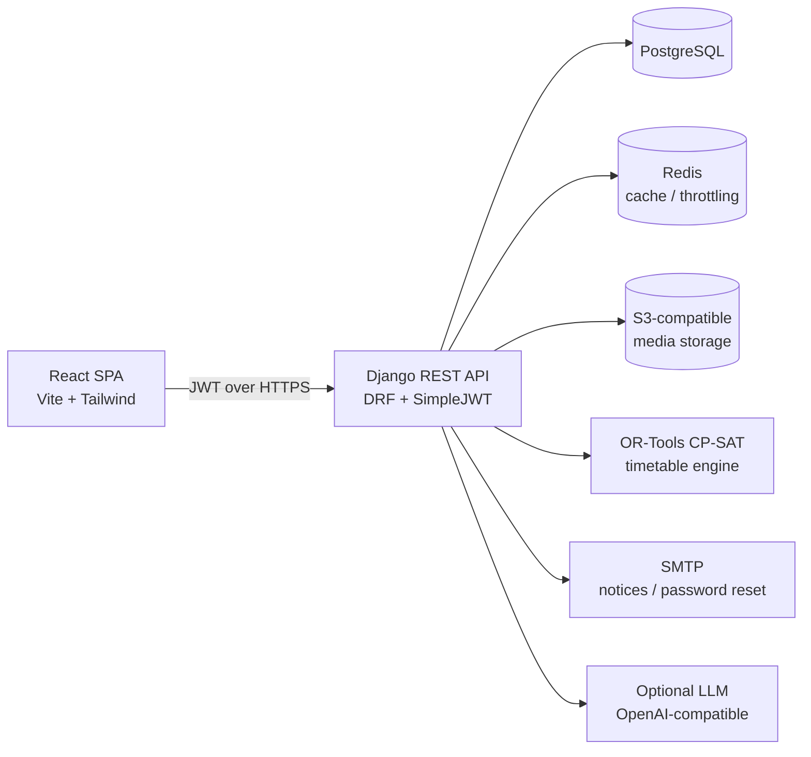

# CampusMind AI

**A centralized, intelligent campus operations platform — scheduling, academics, and the full ERP around them, in one multi-tenant workspace.**

[](https://github.com/subhranshu28-tech/Campus-Mind-AI/actions/workflows/ci.yml)
[](LICENSE)
[](https://www.python.org/)
[](https://nodejs.org/)
[](https://www.djangoproject.com/)
[](https://react.dev/)

CampusMind AI replaces scattered spreadsheets and manual coordination with a single API-backed workspace: constraint-based timetabling, faculty availability and substitutions, exam planning, attendance, notices, and the surrounding academic ERP modules. Every record is scoped to a college tenant, and every privileged action is role-checked and audit-logged.

---

## Why CampusMind AI

| Problem | How CampusMind addresses it |
| --- | --- |
| Timetables built by hand | OR-Tools **CP-SAT optimizer** assigns every weekly class to a conflict-free weekday, period, and room |
| Faculty availability ignored | Availability constraints, substitution suggestions, and leave-driven cover |
| Rooms and labs overbooked | Capacity and lab-eligibility rules enforced during scheduling |
| Exam clashes | Room, section, invigilator, availability, and recurring-class conflict checks |
| Disconnected departments | Notices, events, assignments, fees, library, hostel, transport, and placements in one system |
| Multi-institution use | One isolated workspace per college with application-level tenant scoping |
| No accountability | Append-only, **hash-chained audit log** with per-college verification |

---

## Feature highlights

### 🗓️ Intelligent scheduling
- **Constraint-based timetable generation** with OR-Tools CP-SAT.
- Faculty weekly availability (available-only or unavailable-block modes).
- Room capacity and laboratory eligibility.
- Section / faculty / room collision prevention across semesters.
- Preferences for earlier periods and tighter-fitting rooms.
- Soft per-teacher daily load balancing.
- Live conflict check before moving a class (`dry_run`).
- Excel export by section, faculty, or room.

### 🎓 Academic operations
- Departments, academic years, courses, semesters, sections, subjects.
- Student and faculty profiles with password-hashed accounts.
- Daily attendance with duplicate prevention and corrections.
- Teaching assignments and workload tracking.
- Subject notes and previous-year question papers (PDF, assignment-scoped).
- Exam schedules with automatic invigilation planning.
- Faculty leave requests, approvals, and conflict-free substitute assignment.

### 🏫 Campus ERP modules
- **Notices & events** — audience targeting and email delivery.
- **Assignments** — assignment lifecycle plus student submissions and grading.
- **Fees** — fee structures, invoices, and payments.
- **Library** — catalogue and issue/return tracking.
- **Hostel** — hostels, rooms, and allocations.
- **Transport** — routes, vehicles, and student transport allocation.
- **Placements** — companies, job postings, and applications.

### 📊 Insights & coordination
- Dashboard metrics backed by real database counts.
- Room utilisation, demand heatmap, idle slots, and rule-based insights.
- In-app notifications and a notification bell.
- Optional OpenAI-compatible AI assistant (server-side key only).
- Swagger / ReDoc API documentation.

### 🔐 Security & tenancy
- Secure-by-default production settings (`DEBUG=False`).
- JWT authentication with refresh-token rotation and logout blacklisting.
- College-aware login and role checks.
- Tenant-scoped querysets and write validation.
- Tamper-evident audit-log hash chain.
- CSP and hardening headers, throttling, and optional S3/CDN media.

---

## Architecture



### Tech stack

| Layer | Technology |
| --- | --- |
| Backend | Django 5.1, Django REST Framework, SimpleJWT |
| Optimisation | Google OR-Tools CP-SAT |
| Background jobs | Celery (Redis broker; inline fallback) |
| Database | PostgreSQL (SQLite for local development) |
| Cache / throttling | Redis (optional; in-memory fallback) |
| Frontend | React 18, Vite, Tailwind CSS, React Router, Recharts, Lucide |
| Testing | Django `TestCase`, Vitest, React Testing Library |
| Delivery | Docker Compose, Render Blueprint, nginx, GitHub Actions |

---

## Quick start

### Option A — Docker (fastest)

```bash
cp .env.example .env
# set a long random DJANGO_SECRET_KEY and a private POSTGRES_PASSWORD
docker compose up --build
```

This starts PostgreSQL, Redis, the Django API (`http://localhost:8000`), and an nginx-served React build (`http://localhost:8080`). Migrations and `collectstatic` run automatically at container start.

### Option B — Local development

**Requirements:** Python 3.11–3.13, Node.js 20+, and PostgreSQL 15+ (or SQLite).

1. Configure the environment:

   ```bash
   cp .env.example .env
   ```

   Set a long random `DJANGO_SECRET_KEY`. Keep `DJANGO_DEBUG=true` for local work. Leave `POSTGRES_HOST` unset to use SQLite, or set it to `localhost` to use the Docker database.

2. Install and migrate the backend:

   ```bash
   python -m venv .venv
   source .venv/bin/activate        # Windows: .\.venv\Scripts\Activate.ps1
   pip install -r requirements.txt
   python manage.py migrate
   python manage.py createsuperuser
   python manage.py runserver
   ```

3. Start the frontend in a second terminal:

   ```bash
   cd frontend
   npm install
   npm run dev
   ```

4. Open `http://localhost:5173` and sign in.

> **Demo data:** `python manage.py seed_demo` builds a small college with faculty, students, rooms, and a deterministic conflict-free timetable. Pass `--password` to choose the demo password; otherwise one is printed.

> **Python 3.14 note:** OR-Tools does not yet publish wheels for Python 3.14. Run the optimizer and full test suite on Python 3.11–3.13 (CI uses 3.13). `seed_demo` works without OR-Tools.

---

## API at a glance

Interactive docs are available at **`/api/docs/`** (Swagger) and **`/api/redoc/`**, with the OpenAPI schema at **`/api/schema/`**.

### Authentication
| Endpoint | Purpose |
| --- | --- |
| `POST /api/auth/register-college/` | Create a college tenant and its first admin |
| `POST /api/auth/token/` | JWT login (college-aware) |
| `POST /api/auth/token/refresh/` | Rotate access/refresh tokens |
| `POST /api/auth/logout/` | Revoke the refresh token server-side |
| `GET /api/auth/me/` | Current profile and role |
| `GET /healthz/` | Liveness / database readiness probe |

### Scheduling & operations
| Endpoint | Purpose |
| --- | --- |
| `POST /api/timetable/generate/` | Generate a conflict-free timetable |
| `POST /api/timetable/generate/async/` | Queue generation; poll `/api/timetable/jobs/{id}/` |
| `GET /api/timetable/entries/` | Read timetable entries |
| `GET /api/timetable/entries/{id}/substitutions/` | Subject-qualified substitute suggestions |
| `POST /api/timetable/entries/{id}/move/` | Conflict-checked class move |
| `POST /api/exams/auto-schedule/` | Preview and publish exam schedules |
| `GET /api/analytics/overview/` | Utilisation, heatmap, idle slots, insights |
| `GET /api/exports/timetable/?scope=section&id=…` | Excel export |
| `/api/leaves/`, `/api/substitutions/` | Leave approval and cover |
| `/api/notifications/`, `/api/audit-logs/` | Coordination and audit trail |

### Campus records
`/api/departments/`, `/api/students/`, `/api/faculty/`, `/api/academic-years/`, `/api/courses/`, `/api/semesters/`, `/api/sections/`, `/api/subjects/`, `/api/attendance/`, `/api/classrooms/`, `/api/teaching-assignments/`, `/api/faculty-availability/`, `/api/exam-schedules/`, `/api/subject-notes/`, `/api/question-papers/`.

### ERP modules
| Module | Endpoints |
| --- | --- |
| Notices & events | `/api/notices/`, `/api/events/` |
| Assignments | `/api/assignments/`, `/api/submissions/` |
| Fees | `/api/fee-structures/`, `/api/invoices/`, `/api/payments/` |
| Library | `/api/books/`, `/api/book-issues/` |
| Hostel | `/api/hostels/`, `/api/hostel-rooms/`, `/api/hostel-allocations/` |
| Transport | `/api/transport-routes/`, `/api/vehicles/`, `/api/student-transport/` |
| Placements | `/api/companies/`, `/api/job-postings/`, `/api/placement-applications/` |

All list endpoints support pagination, search, ordering, and filters. Campus administrators and HODs can manage records; faculty can read; students are limited to their own portal and assigned resources.

---

## How the scheduler works

1. Create a department, faculty, academic year, course, semester, section, and subjects.
2. Register active classrooms and laboratories with real seat capacity.
3. Add teaching assignments (section + subject + faculty + periods per week).
4. Optionally add faculty availability rows. Unavailable rows always block a slot; if available rows exist, only those periods are schedulable.
5. Generate the timetable. CP-SAT assigns each weekly lesson to a weekday, period, and eligible room while avoiding section/faculty/room collisions and preserving other semesters.
6. Review substitution suggestions, move classes with live conflict checks, and plan exams with clash detection.

The timetable model is **Monday–Friday, eight periods per day**; exam sessions use the same day. The optimizer is a constraint solver, not a generative model — every assignment is an inspectable database record.

---

## Testing

```bash
# Backend — full suite (136 tests)
python manage.py test apps

# Frontend — unit/component tests (23 tests)
cd frontend && npm test

# Frontend production build + dependency audit
npm run build
npm audit --audit-level=high
```

Backend coverage includes authentication and token revocation, tenant isolation, audit-chain verification, academic and attendance workflows, OR-Tools scheduling, asynchronous job lifecycle, substitutions, exam planning, analytics/export, notices, every ERP module (assignments, fees, library, hostel, transport, placements) including cross-tenant write rejection and student row scoping, and student self-service for assignment submissions and job applications. Frontend tests cover the API auth/refresh interceptors, login, the notification bell, module CRUD flows, pagination, and the error boundary.

CI runs on every push and pull request: critical lint, `check --deploy`, migration drift, the full backend suite with coverage, frontend tests, a production build, and `npm audit`.

---

## Multi-college tenancy

Each college is an isolated workspace. Registration creates the `College` tenant and its first `college_admin` in one transaction; college codes and slugs are unique.

- API querysets and related-object writes are filtered by the authenticated user's `college_id`.
- Operations, exports, analytics, and the optimizer share the same boundary.
- Users without a college receive no tenant data.
- `super_admin` is scoped to its assigned college — it is not a cross-tenant bypass.
- Existing data is preserved by migrations and assigned to a `LEGACY` workspace.

Before opening public registration, rehearse the tenant migration on staging and run a two-tenant isolation smoke test.

---

## Security & configuration

| Variable | Purpose |
| --- | --- |
| `DJANGO_SECRET_KEY` | Required in production; at least 50 characters |
| `DJANGO_DEBUG` | Defaults to `False`; opt in locally with `true` |
| `DJANGO_ALLOWED_HOSTS` / `CORS_ALLOWED_ORIGINS` | Host and origin allow-lists |
| `DATABASE_URL` or `POSTGRES_*` | PostgreSQL connection |
| `REDIS_URL` | Shared cache and throttle counters across workers |
| `EMAIL_*`, `DEFAULT_FROM_EMAIL`, `PASSWORD_RESET_URL` | Password reset and notice email |
| `AWS_*` | Optional S3-compatible persistent media |
| `AI_API_KEY`, `AI_BASE_URL`, `AI_MODEL` | Optional server-side LLM assistant |
| `TIMETABLE_ASYNC_EAGER` | Run timetable generation inline instead of on a worker thread |

Additional protections: JWT refresh rotation with blacklisting, CSP and hardening headers, HSTS/secure cookies in production, scoped throttling, and a tamper-evident audit log. See [SECURITY.md](SECURITY.md) for the deployment checklist and vulnerability reporting.

---

## Deployment

- **Docker Compose** — PostgreSQL, Redis, Django, nginx/React.
- **Render Blueprint** (`render.yaml`) — React static site, Django API, and PostgreSQL.
- **Vercel** — builds and serves the React SPA only.
- **Vercel + Render split** — host the API (and the long-running OR-Tools solver) on Render/Railway/Fly with persistent PostgreSQL and object storage, and keep Vercel for the frontend.

> The Render Blueprint is included but **has not been deployed or verified** in this repository. Free plans can sleep, expire, and lose ephemeral files; use paid/persistent services for real data.

---

## Project structure

```
Campus-Mind-AI/
├── backend/
│   ├── apps/
│   │   ├── accounts/      # users, colleges, tenancy, auth, audit
│   │   ├── campus/        # academics, timetable, attendance, notes
│   │   ├── operations/    # leaves, substitutions, exams, analytics, AI
│   │   ├── notices/       # notices & events
│   │   ├── assignments/   # assignments & submissions
│   │   ├── fees/          # fee structures, invoices, payments
│   │   ├── library/       # books & issues
│   │   ├── hostel/        # hostels, rooms, allocations
│   │   ├── transport/     # routes, vehicles, allocations
│   │   └── placements/    # companies, jobs, applications
│   └── config/            # settings, URLs, middleware
├── frontend/              # React + Vite + Tailwind SPA
├── docs/                  # supporting documentation
├── Dockerfile
├── docker-compose.yml
├── render.yaml
└── requirements.txt
```

---

## Roadmap & current limits

- ✅ Scheduling, academics, attendance, exams, leaves/substitutions, analytics, notices, assignments, fees, library, hostel, transport, placements.
- ✅ Multi-college tenancy, audit hash chain, email notices, background timetable jobs.
- ✅ Green CI with backend and frontend tests.
- ⏳ Live deployment verification (Render/Vercel credentials required).
- ✅ Durable job queue (Celery/RQ) for multi-worker deployments.
- ⏳ Fine-grained department-level object policies.
- ⏳ Configurable school-specific period structures (currently Mon–Fri, 8 periods).

---

## Contributing

See [CONTRIBUTING.md](CONTRIBUTING.md) for local checks and pull-request expectations. Run the backend and frontend suites before opening a PR.

## License

Released under the [MIT License](LICENSE).
